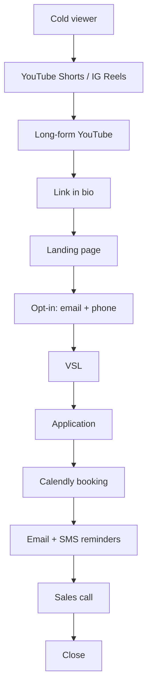

# Creator template

When starting a new creator capture, copy this structure into `creators/{creator-name}/`. Each file is one document. Fill as the capture progresses.

## File: overview.md

```markdown
---
type: synthesis
tags: [funnel-hack, {niche}]
sources: []
created: YYYY-MM-DD
updated: YYYY-MM-DD
---

# {Creator name}

One-paragraph summary: who they are, what niche, what they sell, audience size.

## Niche and positioning
What sub-niche of biz-op are they in? What's their angle / unique mechanism?

## Offer
- Product: {1-on-1 mentoring / group / course / community / mastermind}
- Price: {if known}
- Promise: {transformation they sell}

## Audience size
- YouTube: {subs, total views}
- Instagram: {followers}
- TikTok: {followers}
- Email list (estimated): {if inferable}

## My read

Honest assessment of where their funnel is strong and weak. Save the Pulsify diagnosis for the YouTube script — this section is internal analysis.

## Source trail
Captured {date}. Files: [[attention-layer]], [[funnel-layer]], [[content-breakdown]], [[miro-board]].
```

## File: attention-layer.md

Full Phase 1 data from the capture SOP. Sections:
- YouTube long-form
- YouTube shorts
- Instagram
- TikTok
- Clipping accounts
- Republishing patterns
- Paid ads

Every section ends with `**Screenshots:** [[assets/attention/...]]`.

## File: funnel-layer.md

Full Phase 2 data. Sections:
- Entry points (map of link-in-bio → destinations)
- Landing page
- Opt-in
- Email sequence (table: day, subject, purpose, CTA, link)
- SMS sequence
- VSL
- Webinar
- Application
- Call booking
- Pricing reveal
- Sales call structure
- DM closing
- Retargeting ads

Every section ends with `**Screenshots:** [[assets/funnel/...]]`.

## File: content-breakdown.md

Full Phase 3 synthesis. Sections:
- Pillars
- Title formulas (with examples)
- Thumbnail rules (with examples)
- Hook patterns (with examples)
- Production style
- Authority signals

## File: miro-board.md

Mermaid flowchart of the full A-to-Z journey from cold to closed. Example skeleton:



Below the diagram, narrate the journey step by step with the actual mechanics observed.

## File: assets/

Three subfolders:
- `attention/` — every screenshot from Phase 1
- `funnel/` — every screenshot from Phase 2
- `content/` — every screenshot referenced in content-breakdown.md

Naming convention: `{platform}-{element}-{NNN}.png`. Examples: `youtube-channel-home-001.png`, `ig-profile-001.png`, `email-day3-pitch-001.png`, `vsl-pitch-moment-001.png`.
