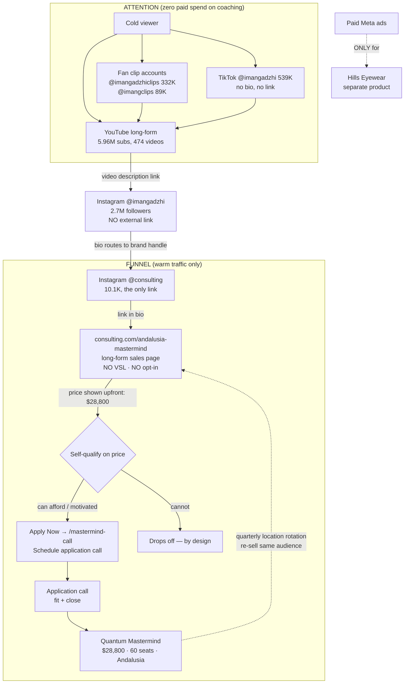
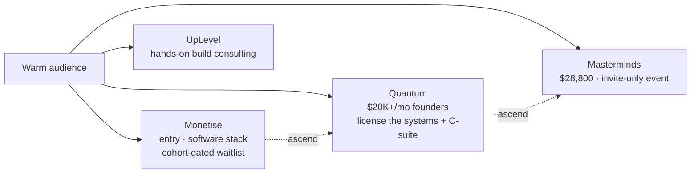

# Iman Gadzhi — A-to-Z map

The full cold-to-closed journey. Mermaid first; render in Miro later if needed for the video.

## Narrated journey

1. **Cold contact** happens on TikTok, fan clip accounts, or YouTube. None of these convert. They build recognition.
2. **YouTube long-form** is the trust engine — the warmest leads arrive having watched multiple long videos. The only on-ramp from YouTube is the description link to Instagram.
3. **@imangadzhi (2.7M)** deliberately has no external link. It exists to push to **@consulting**.
4. **@consulting (10.1K)** is the pre-qualifier. The drop from 2.7M to 10.1K is intentional — only the motivated make the hop. It holds the single funnel link.
5. **Landing page** is long-form copy, no VSL, no opt-in. Price ($28,800) is shown before any call — the page itself is the qualifier.
6. **Apply Now → /mastermind-call** is a call-booking page. The "opt-in" is booking the application call. No lead magnet, no nurture sequence.
7. **Application call** does fit + close.
8. **Quantum Mastermind** delivered; the **quarterly location rotation** (Dubai → Cape Town → London → Andalusia → next) lets them re-sell the same offer to the same audience indefinitely.
9. **Paid ads run in parallel but never touch this funnel** — they sell Hills Eyewear only.

## The offer ladder (what the landing page sits on top of)

Same warm audience, four price points, all application/waitlist-gated. The mastermind funnel we mapped is rung 4. Lower rungs (Monetise) use cohort open/close scarcity and a proprietary software stack (Synthesise, Flozy, GhostWriter OS) as the unique mechanism. Company trades internally as "Educate." Named C-suite (Iman/CEO, Luis Berger/CMO, Max Schliebener/COO, Ali Haider/CPO) is itself a positioning asset.

## The one-sentence version
A near-$29k offer, sold out every quarter, on $0 of funnel ad spend, with no VSL and no email sequence — because 5.96M YouTube subscribers and a free fan-run clip economy do all the warming, and three layers of deliberate friction do all the qualifying.

## Source trail
Built 2026-05-15 from [[attention-layer]], [[funnel-layer]], [[content-breakdown]].
